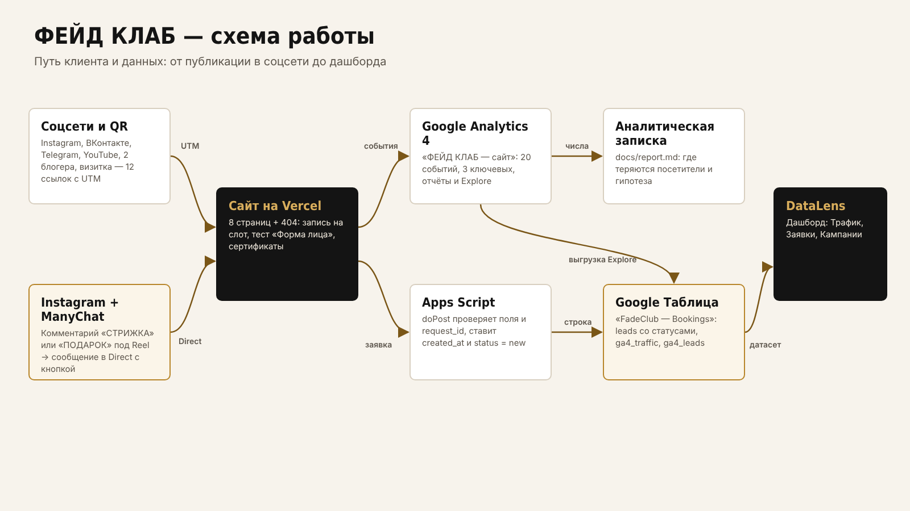
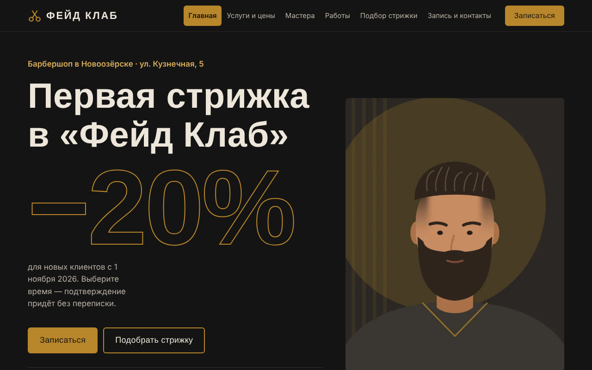
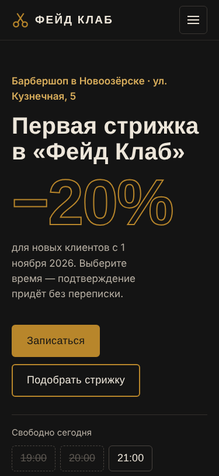
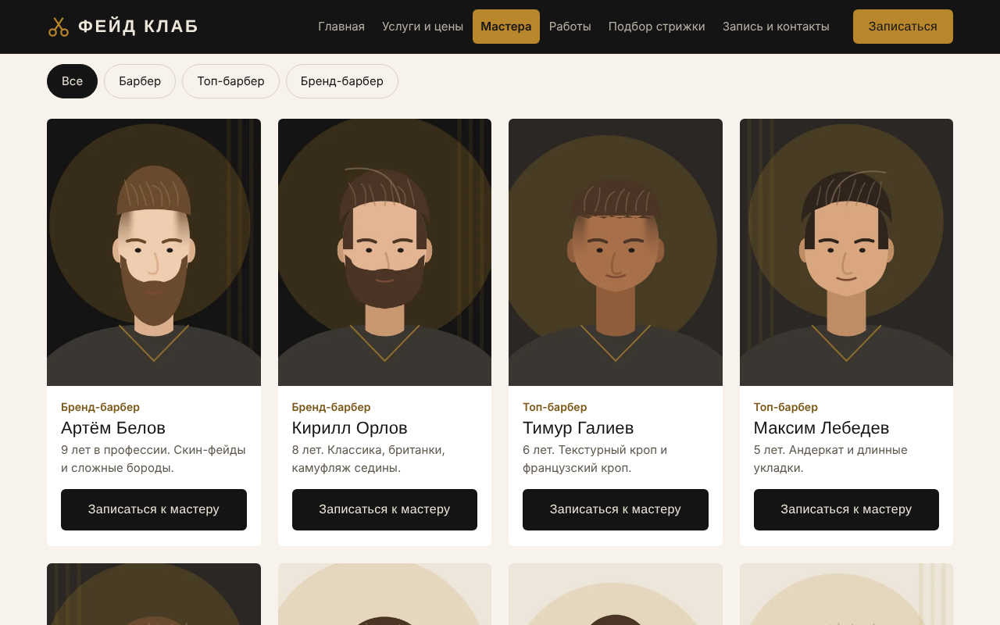
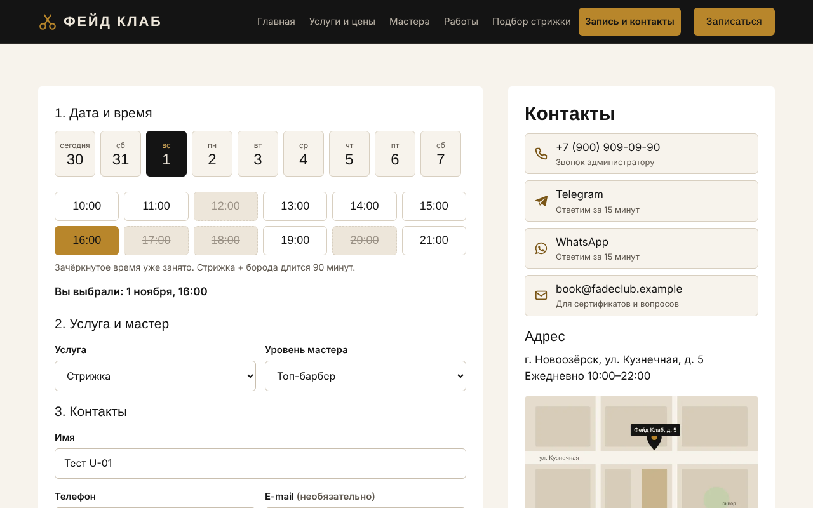
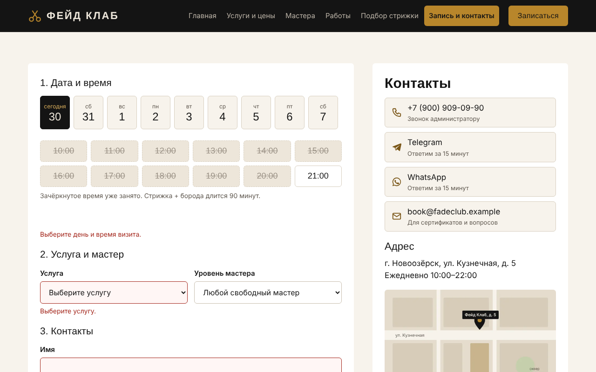
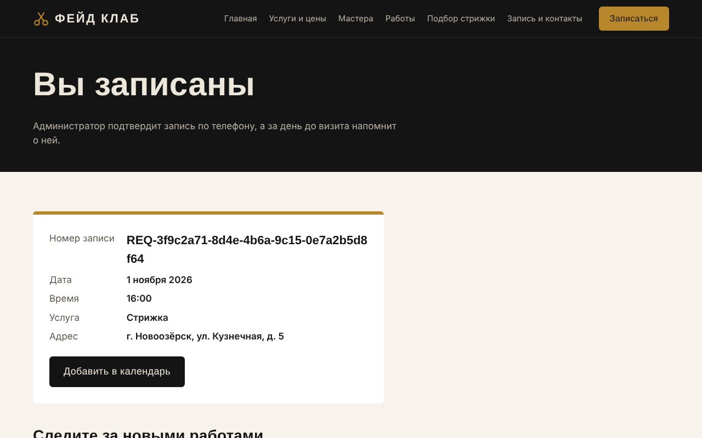
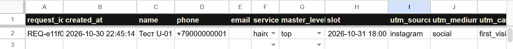
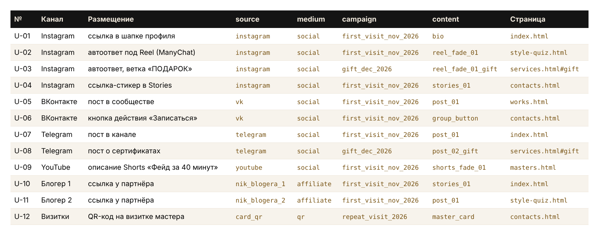
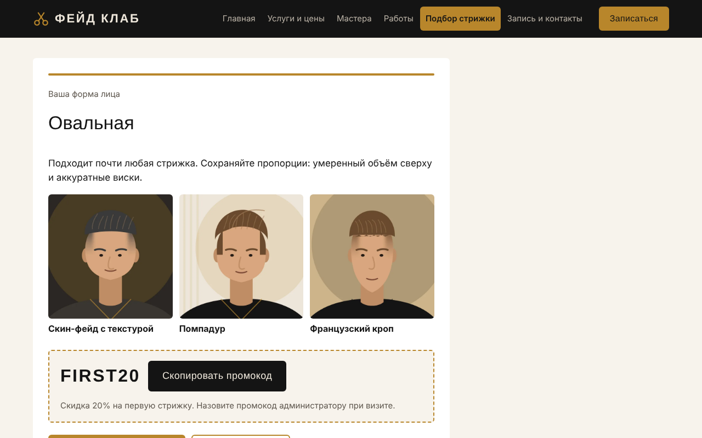

# Описание работы — сайт и сквозная аналитика барбершопа «Фейд Клаб»

Курсовая работа по ОП.03 «Информационные технологии», техническое задание ТЗ-09/2026.

## Задача заказчика

Барбершоп «Фейд Клаб» (6 кресел, 8 мастеров, около 1 900 стрижек в месяц) записывал новых клиентов через переписку в Instagram и по телефону. Вечером и в выходные ответ приходил через 2–3 часа, и клиент записывался в другое место: в сентябре 2026 года из 280 обращений в соцсетях записались 132. Компания платила блогерам 20 000 ₽ в месяц и не знала, сколько клиентов приходит после их видео.

К акции «Первая стрижка −20 %» (с 1 ноября) и продаже сертификатов (с 1 декабря) нужно было: сайт с записью на конкретное время, учёт каждой записи с услугой, мастером и источником, автоответы в Instagram и отчёты по каналам.

## Схема работы

Ссылка с UTM-метками из соцсети, от блогера или с QR-кода либо кнопка из автоответа ManyChat ведёт на сайт. Сайт отправляет события в Google Analytics 4, а заявку — через Apps Script в Google Таблицу. Таблица и выгрузка из GA4 собираются в дашборд Yandex DataLens.

## Шаг 1. Сайт с помощью нейросети

Сайт сделан в Claude Opus 5.5: сначала запрос на структуру, затем отдельный запрос на каждую страницу и запросы на исправления — все 14 запросов в `docs/prompts.md`. Результат — статические HTML, CSS и JavaScript без сборки, 8 страниц и 404. Первый коммит репозитория — результат нейросети без правок, дальше — исправления.

Главный экран построен вокруг акции: крупное «−20%» и полоса «Свободно сегодня» с ближайшими свободными часами, по которым можно сразу перейти к записи.

На телефоне (375 px) нет горизонтальной прокрутки, меню сворачивается в кнопку, все кнопки не меньше 44 × 44 px.

Мастера фильтруются по уровню; кнопка «Записаться к мастеру» открывает форму с уже выбранным уровнем.

Отчёт Lighthouse для главной в мобильном режиме:

## Шаг 2. Запись на конкретное время

На странице «Запись и контакты» календарь на 14 дней и слоты по часу с 10:00 до 21:00. Занятые слоты заданы массивом в `js/main.js` и показаны зачёркнутыми, прошедшие часы сегодняшнего дня недоступны. Выбранное время попадает в скрытое поле `slot`.

Форма проверяет поля до отправки: пустой телефон или телефон «123» не уйдут, под полем появляется понятная подсказка, в GA4 отправляется `form_error`.

После ответа приёмника посетитель попадает на страницу «Спасибо» с номером записи и кнопкой «Добавить в календарь» (файл .ics).

## Шаг 3. Заявки в Google Таблице

Приёмник `apps-script/Code.gs` — веб-приложение Apps Script. Он сам проверяет обязательные поля, телефон (+7 и 10 цифр), e-mail, значения списков и длину строк; повторный `request_id` не создаёт вторую строку. `created_at` и `status = new` ставит приёмник. Функция `setupSheet()` добавляет выпадающий список статусов и подсветку пустых ячеек и дублей.

Администратор ведёт запись по статусам: new → confirmed → reminded → visited или no_show.

## Шаг 4. Аналитика GA4

Ресурс «ФЕЙД КЛАБ — сайт», тег Google в `<head>` всех страниц, включая 404. Сайт отправляет 20 событий: 6 собирает расширенная статистика, 14 программируются в `js/analytics.js` — это единственный файл с вызовами `gtag('event', …)`. Таблица событий с файлами и строками — `docs/events.md`. Ключевые события: `generate_lead`, `contact_click`, `messenger_click`. Зарегистрированы 7 пользовательских параметров.

Событие `generate_lead` отправляется только после ответа таблицы `{"ok": true}`:

Все 20 снимков DebugView — в `screens/ga4/`.

## Шаг 5. UTM-разметка и соцсети

12 ссылок в реестре `docs/utm.csv`: Instagram (шапка профиля, автоответы, Stories), ВКонтакте, Telegram, YouTube, два блогера и QR-код на визитке. Полная ссылка собирается формулой из столбцов меток. UTM-метки сохраняются в `sessionStorage`, поэтому источник не теряется, даже если посетитель пришёл на главную, а записался через несколько страниц.

Для визиток — QR-код `docs/qr-u-12.png` и афиша `docs/afisha.pdf`. Проверки переходов из публикаций — в `screens/utm/`.

## Шаг 6. Автоответы в Instagram

Автоматизация ManyChat «IG · First Visit Nov 2026 · Fade Reel»: комментарий «СТРИЖКА» под Reel — ответ в комментариях и сообщение в Direct с кнопкой «Подобрать стрижку» на тест «Форма лица» (ссылка U-02). Вторая ветка «ПОДАРОК» ведёт на сертификаты (U-03).

Тест из 4 вопросов определяет форму лица, показывает 3 стрижки и промокод FIRST20:

## Шаг 7. Отчёты и исследования

Стандартные отчёты, коллекция «ФЕЙД КЛАБ» в Library, исследования Explore (свободная форма, открытая и закрытая воронка, путь, обратный путь) и оповещение о падении трафика из Instagram — снимки в `screens/reports/` и `screens/explore/`.

Выводы с числами — в аналитической записке `docs/report.md`.

## Шаг 8. Дашборд DataLens

Дашборд «ФЕЙД КЛАБ — first_visit_nov_2026» из трёх вкладок: «Трафик» (данные GA4), «Заявки» (лист leads со статусами) и «Кампании» (сеансы, заявки и визиты по источникам). Селектор периода меняет все виджеты вкладки, имена и телефоны клиентов скрыты.

## Результат для бизнеса

- Клиент записывается сам в любое время суток — ответа администратора ждать не нужно.
- У каждой записи есть услуга, уровень мастера, время и источник; статус показывает, дошёл ли клиент.
- Видно, сколько посетителей и записей дал каждый канал и каждый блогер, — можно сравнить с 20 000 ₽ в месяц.
- Комментарий под Reel за секунды превращается в переход на сайт с промокодом.
